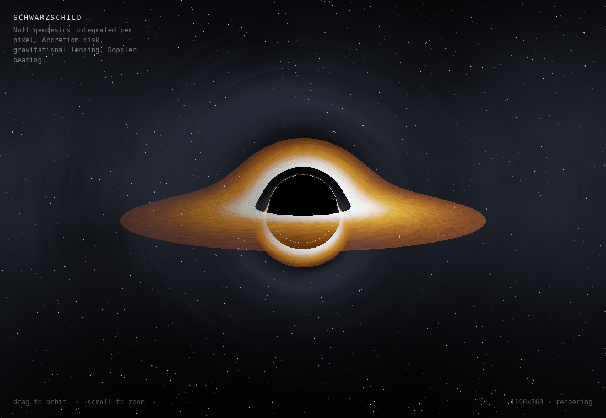

# blackhole-web

A Schwarzschild black hole rendered in real time in the browser. One HTML file, one fragment shader, no dependencies, no build step.



Drag to orbit. Scroll to zoom. That is the whole interface.

## What it actually computes

Every pixel is a photon traced backwards from the camera. Rather than faking the lensing with a screen-space warp, the shader integrates the photon's orbit through the curved spacetime around a non-rotating black hole.

For a Schwarzschild metric, a null geodesic stays in the plane spanned by the camera position and the ray direction. In that plane, with `u = 1/r` and `φ` the orbital angle, the path obeys

```
u'' = -u + 3M u²
```

The shader solves this with RK4, converting the ray's initial radial and tangential components into `u` and `du/dφ`, then marching in `φ`. Positions are reconstructed each step as

```
p(φ) = r(φ) · (cos φ · e₁ + sin φ · e₂)
```

With `rs = 2M = 1`:

| Quantity | Value |
| --- | --- |
| Event horizon | `r = 1` |
| Photon sphere | `r = 1.5` |
| Innermost stable circular orbit (disk inner edge) | `r = 3` |
| Disk outer edge | `r = 12` |

The visible consequences fall out of the integration instead of being drawn: the **photon ring** around the shadow, the far side of the disk bent up over the top, the secondary image underneath, and the sharp cut where rays are captured.

On top of the geodesic:

- **Disk** — a thin emissive sheet. Each crossing of the `y = 0` plane inside the annulus contributes emission with alpha compositing, so higher-order images of the disk appear on their own.
- **Temperature** — `T ∝ r^(-3/4)`, mapping to a blackbody-ish ramp, hot white at the inner edge to deep red at the rim.
- **Doppler beaming** — Keplerian orbital speed `β = √(M/r)` projected onto the photon direction, with brightness scaled by a power of the Doppler factor. The approaching side is brighter, which is why the image is visibly asymmetric.
- **Gravitational redshift** — the inner annulus is dimmed by `√(1 − rs/r)`.
- **Turbulence** — fbm noise in disk-local coordinates, advected by a differential rotation profile (`ω ∝ r^(-3/2)`) so inner material visibly outruns the outer disk.
- **Sky** — procedural star shells plus a faint galactic band, lensed by the same integration.

## Run it

Open `index.html` in a browser. That is it.

To serve it instead (for embedding or phone testing):

```bash
python3 -m http.server 8000
# then visit http://localhost:8000
```

## Performance

The cost is ~420 RK4 steps per pixel, so it is fill-rate bound. A discrete GPU handles a 1440p window comfortably; integrated graphics will want a smaller window. The renderer drops the step count and resolution scale on small viewports. There is a `window.__bh` handle if you want to drive the camera from the console.

## What is approximated, honestly

- **Schwarzschild only** — no spin. A Kerr black hole would need frame dragging and a different geodesic equation.
- **Unlit, optically thin-ish disk** — the sheet emits but does not absorb or re-emit; no radiative transfer, no self-shadowing, no scattering.
- **Newtonian `β` in the beaming term** and a single power law standing in for a full relativistic Doppler + gravitational shift product. The asymmetry is the right sign and roughly the right magnitude; it is not a precision spectrum.
- **Escape radius at `r = 45`** — rays beyond that are assumed to travel straight to the sky, which is accurate to well under a pixel there.
- **No bloom or lens flare** — the glow is tone mapping, not post-processing.

## Layout

```
index.html   the renderer: markup, shader, and camera controls
preview.png  the frame in this README
```

Verified in Chrome with software WebGL (SwiftShader), so it runs on a machine with no GPU as well as on one with.

## License

MIT.
